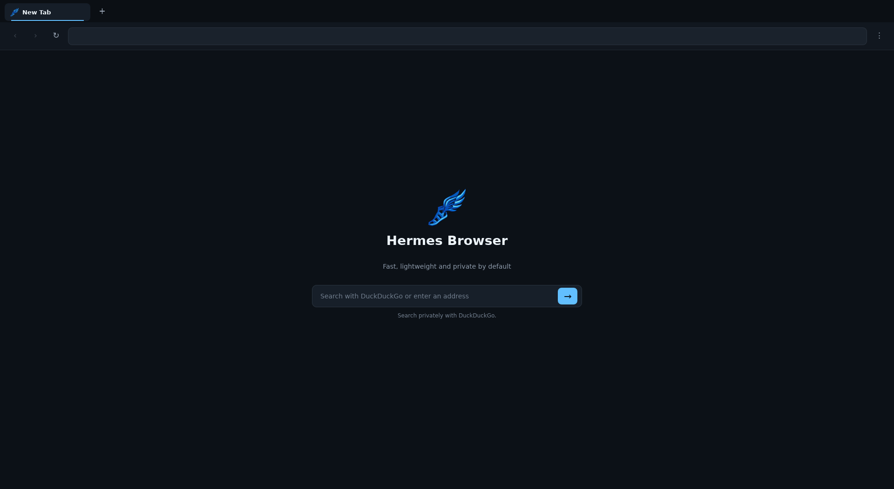
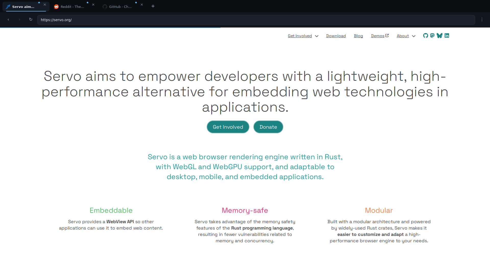

<p align="center">
  
</p>

<h1 align="center">Hermes Browser</h1>

<p align="center">
  <strong>A focused, independent browser powered by Rust and Servo.</strong>
</p>

<p align="center">
  Fast by design. Private by default. Built without the weight of a traditional browser stack.
</p>

<p align="center">
  
</p>

> [!IMPORTANT]
> Hermes is an early technical preview. It is ready for experimentation and development, but not yet for daily use or sensitive browsing.

## A lighter path to the web

Hermes is a desktop browser that combines the memory safety of Rust, the parallel architecture of the [Servo Web Engine](https://servo.org/), and a lightweight native interface built with [Slint](https://slint.dev/).

The project is designed around three principles:

| Performance | Privacy | Independence |
| --- | --- | --- |
| Asynchronous loading, GPU rendering, and aggressive background-tab throttling. | Native network-level ad and tracker blocking using Brave filter snapshots. | A browser shell with clean boundaries around Servo instead of deep engine coupling. |

Hermes takes its name from the Greek messenger associated with speed and travel. Its browser core is called **Talaria**, after Hermes' winged sandals.

## See Hermes in action

<p align="center">
  
</p>

<p align="center">
  <em>Real web content rendered by Servo inside the Hermes tab and navigation experience.</em>
</p>

## Highlights

- **Servo-powered browsing** — modern web content through an embeddable Rust engine
- **GPU-accelerated experience** — WebRender, Vello Canvas 2D, and a native OpenGL interface
- **Native content blocking** — ads and trackers are intercepted before network resources are loaded
- **Responsive tabs** — one dedicated Servo WebView per tab with background throttling
- **Fast navigation** — unified address and search input with DuckDuckGo search
- **Desktop input** — mouse, wheel, keyboard, shortcuts, and IME composition
- **Live page identity** — titles, favicons, navigation history, and loading feedback
- **Cross-platform foundation** — Linux support through X11 and Wayland, plus Windows build configuration

## Technology

```text
Hermes UI · Slint
        │
        │  commands and presentation state
        ▼
Talaria Core · Rust
        │
        │  engine-independent WebView contract
        ▼
Talaria Servo
        │
        ▼
Servo Web Engine
```

| Component | Responsibility |
| --- | --- |
| `apps/hermes-desktop` | Application lifecycle, desktop window, and runtime composition |
| `crates/hermes-ui` | Native Slint interface and presentation types |
| `crates/talaria-core` | Tabs, browser state, commands, events, and navigation policies |
| `crates/talaria-servo` | Servo integration, OpenGL rendering, metrics, and content blocking |

The browser core can be tested with fake WebViews without starting Servo. UI code remains independent from Servo's internal types, keeping the product easier to evolve and the engine easier to upgrade.

## Quick start

Hermes uses the current stable Rust toolchain and the Rust 2024 edition.

```bash
git clone https://github.com/KaykCaputo/hermes-browser.git
cd hermes-browser
make install-linux-deps
make setup
make run
```

`make install-linux-deps` currently supports Debian- and Ubuntu-based Linux distributions. Other distributions need equivalent compiler, Fontconfig, X11, Wayland, and `pkg-config` dependencies.

For an optimized runtime build:

```bash
make run-release
```

### Windows

Build on 64-bit Windows 10 or 11 with:

- the `x86_64-pc-windows-msvc` Rust toolchain;
- Visual Studio 2022 Build Tools with MSVC v143;
- Windows 10 or 11 SDK 10.0.19041.0 or newer;
- C++ ATL for the v143 x64 toolchain.

See the [Servo Windows build requirements](https://book.servo.org/building/windows.html) for environment preparation details.

## Everyday commands

```bash
make check          # Type-check every workspace target and feature
make test           # Run the complete test suite
make qa             # Formatting, Clippy, and tests
make build          # Build the debug workspace
make build-release  # Build the optimized workspace
make run            # Run the development build
make run-release    # Run the optimized build
make package-linux  # Create a Linux archive and checksum
```

Runtime logging can be customized without changing project files:

```bash
make run RUST_LOG="talaria_servo=debug,servo=warn"
```

## Keyboard shortcuts

| Shortcut | Action |
| --- | --- |
| `Ctrl+L` | Focus the address bar |
| `Ctrl+T` | Open a new tab |
| `Ctrl+W` | Close the active tab |
| `Ctrl+Tab` | Select the next tab |
| `Ctrl+Shift+Tab` | Select the previous tab |
| `Ctrl+R` or `F5` | Reload the page |
| `Alt+Left` | Go back |
| `Alt+Right` | Go forward |

## Release builds

Linux and Windows packages are built on native GitHub-hosted runners. Version tags create a GitHub Release automatically:

```bash
git tag v0.1.0
git push origin v0.1.0
```

The release workflow produces:

- `hermes-browser-linux-x86_64.tar.gz` with a SHA-256 checksum;
- `hermes-browser-windows-x86_64.zip` with a SHA-256 checksum.

Manual workflow runs keep both packages as downloadable Actions artifacts without publishing a release. Current packages are intended for testing and are not universal installers.

## Roadmap

- Complete media playback through a production GStreamer backend
- Add permission prompts, downloads, native form controls, and site information
- Persist sessions, history, bookmarks, cookies, and settings
- Introduce multiprocess execution, sandboxing, and crash recovery
- Add per-site content-blocking controls and cosmetic filtering
- Suspend and discard tabs under memory pressure
- Expand automated compatibility testing and upstream Servo contributions
- Ship signed native installers and an update channel

## Project status

The current version is an engineering preview with known limitations:

- Web compatibility follows Servo's current implementation maturity.
- Multimedia playback does not yet use the production GStreamer backend.
- The browser currently runs a single window without multiprocess site isolation.
- Persistence, downloads, permission prompts, extensions, and private profiles are not implemented yet.
- Background tabs are throttled but are not yet suspended or discarded.
- Linux packages currently target x86-64 and depend on compatible system libraries.

When a page exposes an engine-level failure, reproduce it in Servo's `servoshell` before maintaining a Hermes-specific engine patch.

## Contributing

Hermes is a practical space for exploring browser engineering in Rust. Focused bug reports, compatibility reproductions, tests, documentation improvements, and well-scoped pull requests are welcome.

Before submitting a change, run:

```bash
make qa
```

## License

No open-source license has been selected yet. Until a license file is added, the source code remains under its authors' default copyright.
