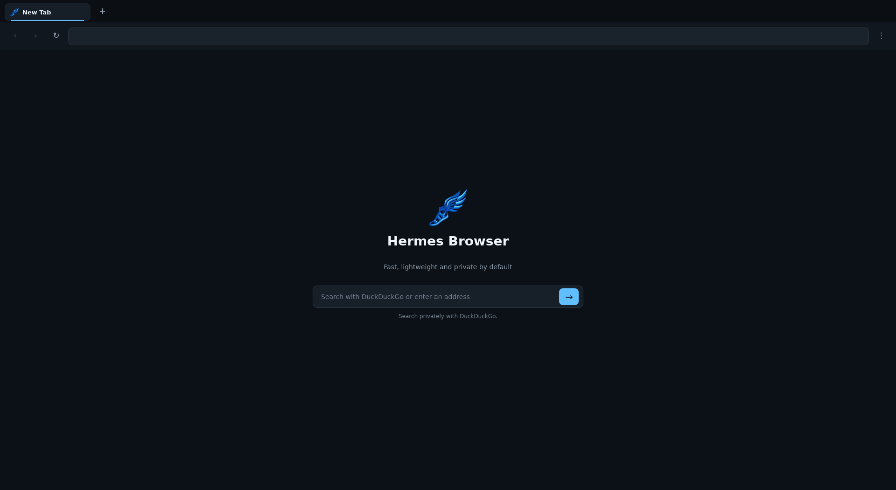
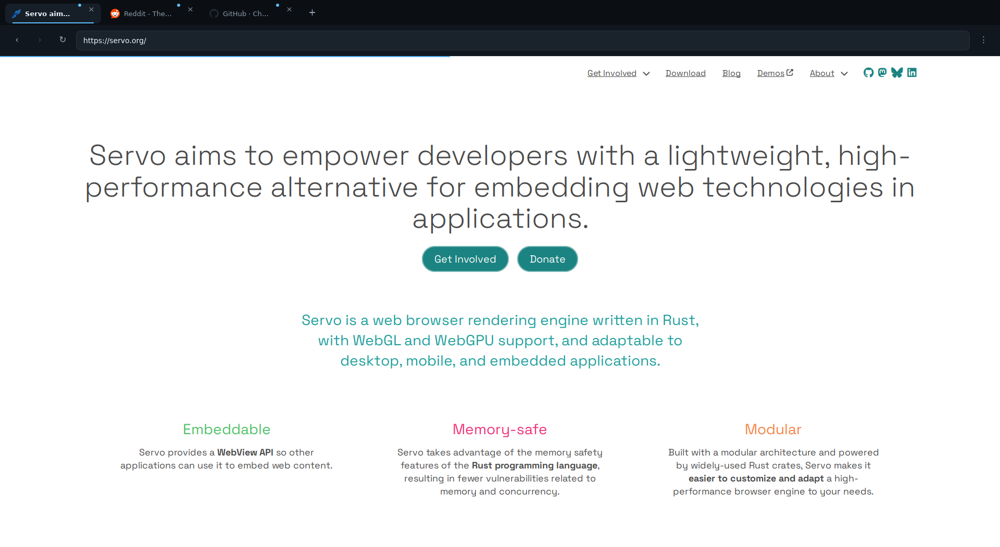

<section class="mercury-hero">
  

    

      
      Mercury Browser
    

    <h1>A focused browser, built on a different engine.</h1>
    
Mercury pairs Servo's independent web engine with a lightweight native Rust interface. Explore the browser today, or help shape the path toward a faster and more open web.

    

      <a href="user-guide/installation/" class="md-button md-button--primary">Get started</a>
      <a href="developer-guide/" class="md-button">Developer guide</a>
    

  

  

    
  

</section>

  

    <strong>Rust from interface to engine</strong>
    Memory-safe foundations across the browser stack
  

  

    <strong>Independent rendering</strong>
    Powered by Servo, WebRender, and Vello
  

  

    <strong>Native Linux media</strong>
    Audio and video through GStreamer
  

<section class="mercury-section">
  

    
One project, two paths

    <h2>Find the documentation written for you.</h2>
    
You should not need to understand Servo internals to run Mercury, and you should not need to search user tutorials for architectural decisions. Both guides live in one searchable site while staying focused on their audience.

  

  

    <article class="mercury-card">
      USER GUIDE
      <h3>Browse with clear expectations</h3>
      
Install Mercury, learn its tabs and shortcuts, set up Linux media, and understand today's privacy and compatibility boundaries.

      <a href="user-guide/">Explore the User Guide →</a>
    </article>
    <article class="mercury-card">
      DEVELOPER GUIDE
      <h3>Understand the browser as a system</h3>
      
Follow commands and frames through the codebase, work safely around Servo, test changes, and maintain the project's focused patches.

      <a href="developer-guide/">Explore the Developer Guide →</a>
    </article>
  

</section>

<section class="mercury-section">
  

    
Built with purpose

    <h2>A small browser shell with serious foundations.</h2>
  

  

    <article class="mercury-card">
      01
      <h3>Servo-powered browsing</h3>
      
Modern web content runs through an embeddable engine written for parallelism and memory safety.

    </article>
    <article class="mercury-card">
      02
      <h3>Native desktop experience</h3>
      
Slint, winit, and WGPU provide responsive tabs, navigation, keyboard input, and IME composition.

    </article>
    <article class="mercury-card">
      03
      <h3>Blocking before load</h3>
      
Brave's default filter snapshot stops known advertising and tracking subresources at the network boundary.

    </article>
    <article class="mercury-card">
      04
      <h3>Linux multimedia</h3>
      
Servo's GStreamer backend handles supported HTML audio, video, Web Audio, and WebRTC pipelines.

    </article>
    <article class="mercury-card">
      05
      <h3>Engine-neutral core</h3>
      
Talaria keeps tabs, state, commands, and navigation policy testable without starting a browser engine.

    </article>
    <article class="mercury-card">
      06
      <h3>Honest engineering</h3>
      
Known limits are documented directly, including site compatibility and the current lack of OS sandboxing.

    </article>
  

</section>

<section class="mercury-showcase">
  
  

    
A real browser, in progress

    <h2>Native chrome. Independent web engine.</h2>
    
Every tab owns a Servo WebView. Mercury routes native input into the engine and brings page titles, favicons, history, loading state, and rendered frames back into a focused desktop experience.

    <a href="developer-guide/architecture/">See how the layers fit together →</a>
  

</section>

<aside class="mercury-preview">
  
  

    <h2>Mercury is an engineering preview.</h2>
    
Web content runs in isolated content processes without operating-system sandbox restrictions. Use known sites and non-sensitive data while that security boundary is hardened.

  

  <a href="user-guide/privacy-and-security/">Read the security model →</a>
</aside>

